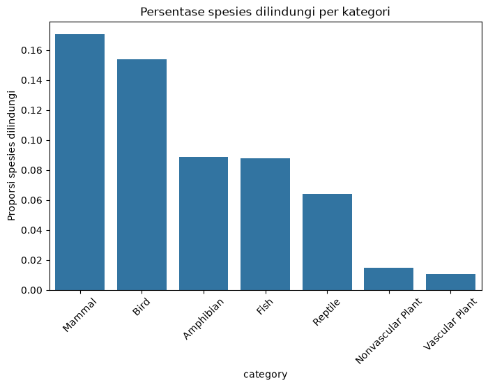
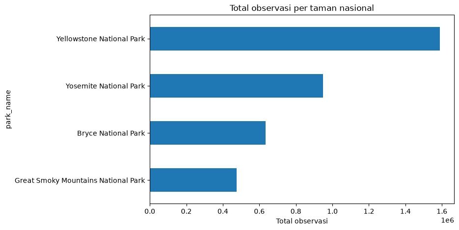

# Biodiversity in National Parks

Analisis data National Park Service (NPS) tentang status konservasi spesies di empat taman nasional.
Proyek ini dikerjakan sebagai portfolio project untuk latihan workflow analisis data: mulai dari memuat
data, membersihkan, memvisualisasikan, menguji hipotesis, sampai menyusun kesimpulan dan presentasi.

## Pertanyaan yang ingin dijawab

Kategori spesies apa yang paling banyak masuk daftar dilindungi di taman nasional?

## Data

| File | Baris | Isi |
|---|---|---|
| `species_info.csv` | 5.824 | Kategori, nama ilmiah, nama umum, dan status konservasi tiap spesies |
| `observations.csv` | 23.296 | Jumlah kemunculan spesies di empat taman selama 7 hari pengamatan |

Empat taman yang tercatat: **Yellowstone**, **Yosemite**, **Bryce Canyon**, dan **Great Smoky Mountains**.

## Metode

1. Memuat kedua CSV dan memeriksa struktur datanya (`shape`, `info`, `describe`).
2. Mengisi nilai kosong pada kolom `conservation_status` menjadi `No Intervention`.
3. Menghitung proporsi spesies dilindungi untuk setiap kategori.
4. Menguji signifikansi hubungan kategori dengan status konservasi memakai uji **chi-square**.
5. Membandingkan total observasi antar taman nasional.

## Hasil

### 1. Status konservasi

| Status | Jumlah |
|---|---|
| No Intervention | 5.633 |
| Species of Concern | 161 |
| Endangered | 16 |
| Threatened | 10 |
| In Recovery | 4 |

Hanya **191 spesies** (sekitar 3,3%) yang berstatus dilindungi.

### 2. Proporsi spesies dilindungi per kategori



| Kategori | Total | Dilindungi | Proporsi |
|---|---:|---:|---:|
| Mammal | 176 | 30 | 17,0% |
| Bird | 488 | 75 | 15,4% |
| Amphibian | 79 | 7 | 8,9% |
| Fish | 125 | 11 | 8,8% |
| Reptile | 78 | 5 | 6,4% |
| Nonvascular Plant | 333 | 5 | 1,5% |
| Vascular Plant | 4.262 | 46 | 1,1% |

Mamalia dan burung punya proporsi paling tinggi, sementara tumbuhan paling rendah.

### 3. Uji chi-square

```
chi2 = 628,58
p-value = 2,46 x 10^-117
```

Karena p-value jauh di bawah 0,05, hubungan antara kategori spesies dan status konservasinya
**signifikan** — pola di atas bukan kebetulan.

### 4. Observasi per taman



| Taman | Total observasi |
|---|---:|
| Yellowstone National Park | 1.587.641 |
| Yosemite National Park | 949.452 |
| Bryce Canyon National Park | 633.291 |
| Great Smoky Mountains National Park | 474.863 |

## Kesimpulan

1. Sebagian besar spesies belum masuk program konservasi; yang masuk paling banyak berstatus *Species of Concern*.
2. Mamalia dan burung punya proporsi dilindungi paling tinggi, tumbuhan paling rendah.
3. Kategori spesies berhubungan signifikan dengan status konservasinya (p < 0,05).
4. Yellowstone mencatat total observasi paling banyak.

## Isi repository

```
biodiversity.ipynb            notebook analisis (sudah dijalankan lengkap dengan output)
Biodiversity_Rolin.pptx       slide deck versi Inggris
Biodiversity_Rolin_ID.pptx    slide deck versi Indonesia
Biodiversity_Rolin.pdf        slide deck versi Inggris (PDF)
Biodiversity_Rolin_ID.pdf     slide deck versi Indonesia (PDF)
preview.html                  notebook dalam bentuk HTML
assets/chart1.png             grafik proporsi spesies dilindungi
assets/chart2.png             grafik total observasi per taman
assets/foto/                  foto empat taman nasional
species_info.csv              data mentah
observations.csv              data mentah
```

## Cara menjalankan

```bash
pip install pandas numpy matplotlib seaborn scipy jupyter
jupyter notebook biodiversity.ipynb
```

Jalankan sel dari atas ke bawah (Shift + Enter).

## Sumber

- Data: [National Park Service](https://www.nps.gov/) — dataset proyek Codecademy.
- Foto taman: [Wikimedia Commons](https://commons.wikimedia.org/).

---

**Rolin** · 19 September
